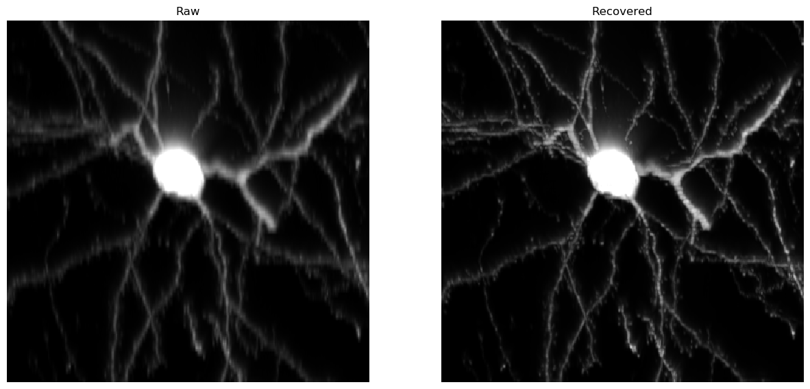
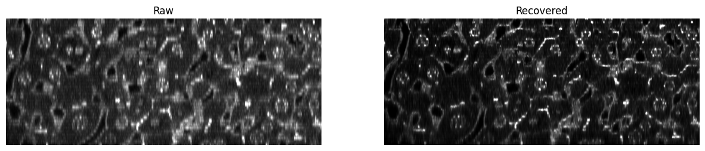

# SSAI-3D: System- and Sample-agnostic Isotropic 3D Microscopy

<!--  -->

## News

- **2025-01**: SSAI-3D is published in [Nature Communications](https://www.nature.com/articles/s41467-025-56078-4).
- **2026-10**: We reorganised the code to make it easier to use: an installable package, a one-command pipeline (`ssai3d run`), GPU memory limits and several bug fixes (see [CHANGELOG.md](CHANGELOG.md)). The code as published is kept under the tag [`v1.0-paper`](https://github.com/You-Lab-MIT/SSAI-3D/tree/v1.0-paper).
- **2026-10**: We are excited to share two follow-up works that build on SSAI-3D and benchmark against it:
  - **DeepIso**: self-supervised internal learning for isotropic 3D fluorescence microscopy. Wei, ..., Guo, Liu, [*Laser & Photonics Reviews* (2026)](https://doi.org/10.1002/lpor.71963).
  - **MicroFM**: physics-guided flow matching with microscope-matched PSFs and an implicit volumetric prior. Zhan, Jiang, ..., Xu, [*CVPR* 2026](https://openaccess.thecvf.com/content/CVPR2026/papers/Zhan_MicroFM_Physics-guided_Flow_Matching_for_Isotropic_Microscopy_Reconstruction_CVPR_2026_paper.pdf).

## Overview

This repository provides the implementation and resources for [SSAI-3D (Nature Communications 2025)](https://www.nature.com/articles/s41467-025-56078-4), a deep learning framework for achieving high-fidelity isotropic 3D resolution recovery in microscopy. SSAI-3D is a weakly physics-informed, domain-shift-resistant framework demonstrated across diverse microscopy system and a wide array of 3D biological samples.


---

## Installation

Requires Python 3.9+ and PyTorch 1.13+ (tested with Python 3.10, PyTorch 2.5, CUDA 12.4). A GPU is recommended; about 8 GB of GPU memory is enough for the default settings.

```bash
git clone https://github.com/You-Lab-MIT/SSAI-3D.git
cd SSAI-3D
conda env create -f environment.yml    # or, in an existing env with PyTorch: pip install -e .
conda activate ssai3d
ssai3d download --demo-data            # weights -> weights/, demo stack -> demo/raw_data.tif
```

The code as published with the paper is tagged [`v1.0-paper`](https://github.com/You-Lab-MIT/SSAI-3D/tree/v1.0-paper). See [CHANGELOG.md](CHANGELOG.md) for what changed since.

---

## Quick start

Input is one 3D TIFF with shape `(Z, Y, X)`. `downsample` is the axial step divided by the lateral pixel size (5 for the demo).

**Fine-tune on your stack and restore it** (best quality):

```bash
cp ssai3d/configs/example_run.yml my_run.yml   # set raw, out_dir, downsample
ssai3d run my_run.yml
```

This prepares semi-synthetic training pairs, ranks layers with the surgeon network, sparsely fine-tunes, restores the XZ and YZ views and averages them into `<out_dir>/<name>_restored.tif` with shape `(Z * downsample, Y, X)`. Finished steps are skipped when the command is rerun; `--steps restore,fuse` runs a subset and `--force` redoes them. Run time and peak GPU memory per step are written to `<out_dir>/metrics.json`.

**Restore with an existing network** (no fine-tuning):

```bash
ssai3d restore my_stack.tif --model weights/generalizable_model.pth --out results/my_stack
```

**GPU memory:** `gpu: 1` selects the device and `max_mem_gb: 10` caps this process (CUDA context included). The environment variable `SSAI3D_MAX_MEM_GB=10` does the same for notebooks and scripts. Restoring a 970 × 893 px slice takes about 3.4 GB and memory grows with slice area. Slices that do not fit are processed in overlapping tiles (`restore.tile` forces this). Tiling changes the output slightly, because NAFNet's local pooling depends on input size: on the demo, the mean difference is 0.03% of the range and the 99th percentile 0.3%. Fine-tuning with the default 500 px crops needs about 9 GB; lower `train.gt_size` to reduce it.

| Released weights | Use |
|---|---|
| `NAFNet-REDS-width64.pth` | pre-trained starting point for fine-tuning |
| `generalizable_model.pth` | fine-tuned on several 3D datasets; quick tests on new data |
| `net_g_neurons.pth` | fine-tuned on the mouse brain neuron demo stack |
| `denoising_model.pth` | optional denoiser for noisy stacks (`weights.denoise`) |

---

## Demonstration notebooks

The notebooks in `demo/` run the same steps through the Python API. By default they restore the sub-volume `[:80, :400, :500]` of the demo stack so they finish in minutes; set `CROP = None` for the full stack.

> **1. Fine-tuning (`demo/demo_train.ipynb`)**: sparse fine-tuning and axial deblurring on one stack, with an optional denoising variant. About 15 minutes, plus 15 for the denoising part.
>
> **2. Testing (`demo/demo_test.ipynb`)**: restoration of the neuron demo stack with the network fine-tuned on it, compared with the pre-trained network. About 5 minutes.
>
> **3. Generalizable model (`demo/demo_generalizable.ipynb`)**: restoration of any stack with the multi-dataset network. Fine-tuning gives better results. About 3 minutes.

Runtimes were measured on an NVIDIA RTX A6000 shared with another job, with the memory cap at 10 GB.

Data: [mouse brain neurons](https://drive.google.com/file/d/1p3CUWhaSJXAA_9k8p4nRrhjBmbegQ-vJ/view?usp=sharing) (downloaded by `ssai3d download --demo-data`) or [mouse liver](https://www.nature.com/articles/s41592-018-0216-7#data-availability).

#### Expected outcomes

Results on the mouse brain neuron and mouse liver stacks:




---

## Repository layout

```
ssai3d/            SSAI-3D: data preparation, surgeon, fine-tuning, restoration, CLI
  configs/         network configs and example_run.yml (all run options with defaults)
  assets/          surgeon MLP weights
basicsr/           vendored NAFNet / BasicSR engine (networks, losses, data loading)
demo/              notebooks
tests/             unit tests (pytest)
```

---

## References
Please cite the following published paper for this framework.

```
@article{han2025system,
  title={System-and sample-agnostic isotropic three-dimensional microscopy by weakly physics-informed, domain-shift-resistant axial deblurring},
  author={Han, Jiashu and Liu, Kunzan and Isaacson, Keith B and Monakhova, Kristina and Griffith, Linda G and You, Sixian},
  journal={Nature Communications},
  volume={16},
  number={1},
  pages={745},
  year={2025},
  publisher={Nature Publishing Group UK London}
}
```

### Follow-up works

Full citations for the follow-up works listed under News:

```
@article{wei2026self,
  title={Self-Supervised Internal Learning Enhances Isotropic Resolution for Three-Dimensional Fluorescence Microscopy},
  author={Wei, Mingzhe and Xu, Pengcheng and Liu, Junyu and Li, Xuesong and Feng, Xuhui and Zhu, Jun and Dong, Renwei and Ran, Hengjia and Zhu, Wentao and Han, Yubing and Li, Yue and Guo, Min and Liu, Huafeng},
  journal={Laser \& Photonics Reviews},
  pages={e71963},
  year={2026},
  doi={10.1002/lpor.71963}
}

@inproceedings{zhan2026microfm,
  title={MicroFM: Physics-guided Flow Matching for Isotropic Microscopy Reconstruction},
  author={Zhan, Xingzu and Jiang, Runmin and Gupta, Vatsal and Swaminathan, Tanush and Wang, Yanwen and Zhang, Genpei and Wang, Haili and Xu, Min},
  booktitle={Proceedings of the IEEE/CVF Conference on Computer Vision and Pattern Recognition (CVPR)},
  year={2026}
}
```
